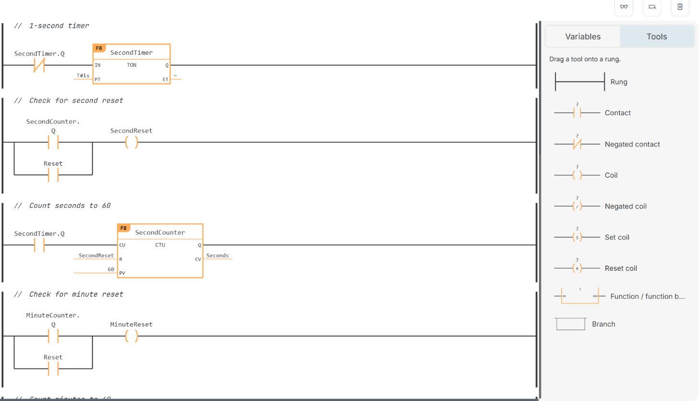
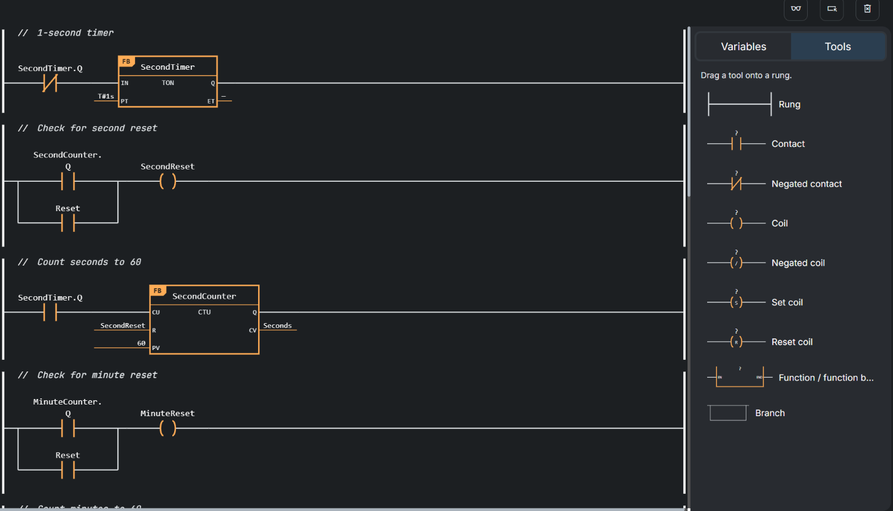
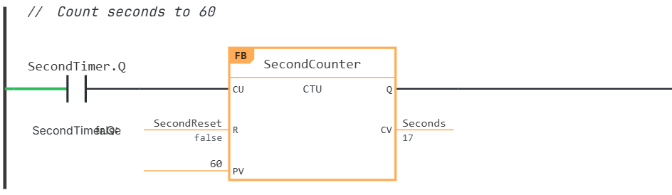
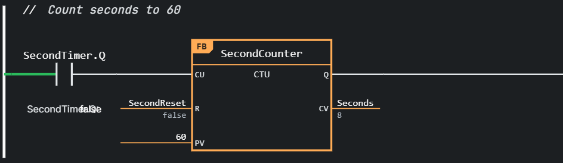

Ladder Diagram (LD) is a graphical programming language from the IEC 61131-3 standard. A program is drawn as a series of **rungs** between two vertical power rails: conditions (contacts) on the left decide whether the actions (coils and function calls) on the right are executed. OTee supports Ladder Diagram for programs, functions, and function blocks, alongside Structured Text (ST).

Behind the scenes, OTee translates your diagram into IEC 61131-3 Structured Text when the project is built, so a ladder POU compiles, deploys, and runs like any other POU in your project.

## Create a ladder POU

In the Project Browser, press the (+) next to the POU category you want (for example Programs). In the "Create an entity" dialog, choose **Ladder Diagram (LD)** from the Language drop-down, give the POU a name, and press "Save". The POU opens in the ladder editor instead of the code editor.

## The ladder editor

The editor shows your rungs in the main area. On the right-hand side, the same panel that holds your variables has a second tab, **Tools**, containing everything you can place on a rung. Switch between the two with the Variables / Tools tabs at the top of the panel.

Declare your variables in the Variables tab exactly as you would for an ST POU (see [User Interface](/ide/user-interface)). Ladder diagrams then refer to those variables by name.

## Build a rung

Drag a **Rung** from the Tools tab into the editor to start a new one. Then drag the elements you need onto the rung's wire. As you drag, the editor shows where the element will land before you release the mouse button.

| Tool | Purpose |
| --- | --- |
| Contact | Passes power when its BOOL variable is TRUE. |
| Negated contact | Passes power when its BOOL variable is FALSE. |
| Coil | Sets its BOOL variable to the state of the rung. |
| Negated coil | Sets its BOOL variable to the opposite of the rung's state. |
| Set coil | Latches its BOOL variable to TRUE when the rung is true, and leaves it unchanged otherwise. |
| Reset coil | Latches its BOOL variable to FALSE when the rung is true, and leaves it unchanged otherwise. |
| Function / function block | Calls a function or function block. See below. |
| Branch | Splits the wire into parallel paths. See below. |

A freshly dropped element is empty. To assign a variable, double-click the element (or select it and press Enter) and start typing the variable's name. The editor suggests matching variables from your POU, together with their data types. Press Escape or click anywhere outside the element to finish editing.

You can add a short comment above any rung by typing into the `// comment` field that appears when you point at the rung.

### Rules for a valid rung

The editor checks your rungs while you work and marks problems with a red icon, both on the offending element and at the top right of the rung. Hover over the icon to read the message. A rung is valid when:

- it contains at least one action, such as a coil or a function block call, on its right-hand side. A rung made of conditions only is not valid.
- conditions (contacts and comparisons) come before actions. Actions, in particular coils, are never placed on the left of a condition.
- every branch holds either only conditions (an OR of conditions) or only actions (parallel outputs), never a mix of both.

### Branches

Drop a **Branch** onto a rung to create two parallel paths. Drop further elements into either path to build the logic you need: contacts side by side form an OR, while several coils on separate paths form parallel outputs. Branches can be nested. Drag either end of a branch to attach it to a different point on the same rung.

### Function and function blocks

Drop a **Function / function block** onto a rung to call one. Select its kind first, then use the **type** field to pick what to call. For functions, the picker has quick buttons for common operators (`+`, `-`, `*`, `/`, and comparisons) and a searchable list of all standard and project functions. Some functions have a **dtype** field to choose the data type they operate on. Functions such as ADD accept additional inputs through "+ argument".

For function blocks, you additionally pick an **instance**: a variable of that function block type. Choose an existing one, or select "+ New" to declare one on the spot.

Fill in the input pins with a variable, a constant, or an expression, and the output pins with the variable that should receive the result. A block shows **FC** or **FB** in its upper left corner, so you can tell at a glance whether it is a function or a function block. Functions carry rung power through their EN and ENO pins, while function blocks carry it through one of their BOOL pins.

### Drag and drop from your project

Instead of picking everything from drop-downs, you can also drag items into a rung directly from the rest of the editor. While a ladder POU is open:

- **Functions and function blocks:** drag a function or function block from the Project Browser onto a rung. The editor outlines where it will land, and when you release the mouse button the block is inserted with its type and pins already filled in. For a function block, you then choose or create an instance, as described above.
- **Variables:** drag a variable from the Variables tab onto the diagram. Dropped onto an existing contact or coil, a BOOL variable replaces the variable that element refers to. Dropped onto a pin of a function or function block, any variable is connected to that pin. Dropped on an empty spot between elements, a BOOL variable creates a new contact or coil (you choose which), and a variable whose type is a function block creates a call to that function block using the variable as its instance.

The element under your pointer lights up while you drag, so you can see what the drop will do before you release.

## Select, move, and edit

- Click an element to select it, or click a rung's left rail to select the whole rung. Hold Shift to extend a selection, or drag a rectangle on empty space to select everything it touches.
- Move selected elements by dragging them, and reorder rungs by dragging the handle at the top left of a rung. Alt + Up / Down also moves the selected rungs.
- Use the arrow keys to move the selection around the diagram.
- Copy, cut, and paste with Ctrl + C, Ctrl + X, and Ctrl + V. This works for whole rungs as well as for groups of elements, and also between different ladder POUs.
- Delete the selection with Delete or Backspace. A rung also has a trash icon in its lower left corner.

## Show live values

When your project is connected to a running vPLC, press the glasses button above the editor ("Display live tag values") to see the current state of your program inside the diagram. If more than one tag source is available, pick the one you want from the drop-down that appears above the diagram.

With live values on, the current value of each variable is shown at its element, including the pins of function blocks. Wires turn green where power is flowing and stay grey where it is not. Open contacts are not highlighted in any special way; they simply stop the flow.

<Info>
Live values are sampled about once per second and are a close indication of your program's state, not a trace of individual PLC scans. Values of different variables may come from different scans.
</Info>
