A library is a collection of reusable PLC logic that you author once and use in any number of projects. Instead of copying a function from project to project, you keep it in a library, release it as a numbered version, and let each project decide when to adopt a new version.

<Note>
Library Management may require you to upgrade your plan.
</Note>

## What a library contains

A library holds three kinds of entities:

- **Data Types**
- **Functions**
- **Function Blocks**

Functions and function blocks can be written in Structured Text (ST) or [Ladder Diagram (LD)](/projects/ladder-diagram). A library cannot contain programs, a configuration, or driver configurations, because those belong to a single deployable project. A PLCopen XML file that contains them is rejected when you import it.

Entity names must be unique across your project and all the libraries enabled in it. If two entities share a name, the project cannot be built. The exception is an [override](#override-a-library-entity), which deliberately replaces a library entity with a local copy.

## The Libraries page

Open the Libraries page with the Libraries icon in the top bar. It lists every library in your organization.

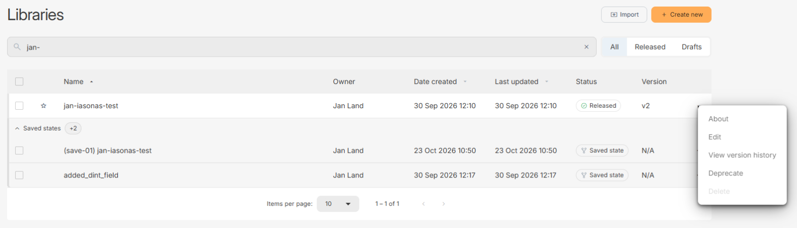

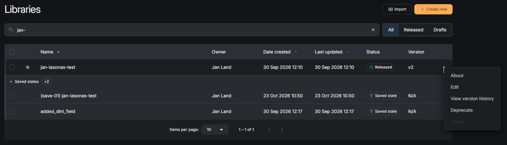

Each row shows the library's owner, when it was created and last updated, its status, and its latest version (`N/A` if it has never been released). Use the search field to find a library by name, the **All / Released / Drafts** switch to narrow the list, and the column headers to sort by name, creation date, or last update. Press the star next to a library to mark it as a favourite, or select several rows to favourite or unfavourite them together.

A library that has saved states or drafts shows them in a group under its row. Press the group's header to expand it, or use **Expand all**.

Every library has one of these statuses:

| Status | Meaning |
| --- | --- |
| Draft | A library that has never been released. Its content is a working copy. |
| Released | A numbered, unchangeable version of the library. |
| Deprecated | A released version that has been marked as no longer recommended. |
| Saved state | A saved working copy of a library that already has released versions. |

The **...** menu at the end of a row offers these actions:

- **Release**: publishes a library that has never been released.
- **About**: shows the library's details and the projects that use it.
- **Edit**: opens the library in the library editor.
- **View version history**, **Deprecate**, and **Rollback**: see [Versions and deprecation](#versions-and-deprecation).
- **Delete**: removes the library. This is disabled while any project uses the library, and the tooltip tells you how many.

## Create or import a library

Press **Create new**, enter a name and an optional description, and press "Save". Library names can contain latin letters, numbers, `_` and `-`, up to 128 characters, and must be unique in your organization. Descriptions can be up to 512 characters.

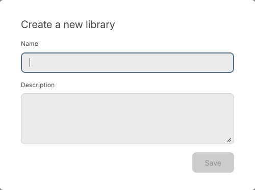

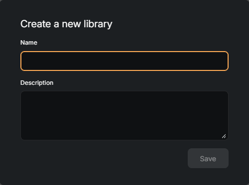

To start from existing code, press **Import**, drop a PLCopen XML file on the dialog, and confirm the name and description. The name is pre-filled from the file name.

## Edit a library

Press a library's row, or choose **Edit** in its menu, to open the library editor. It works like the project editor, but its browser only shows Data Types, Functions, and Function Blocks. A badge shows that you are editing a library, and a second badge shows which state you have open: Draft, Released, Deprecated, or Saved state.

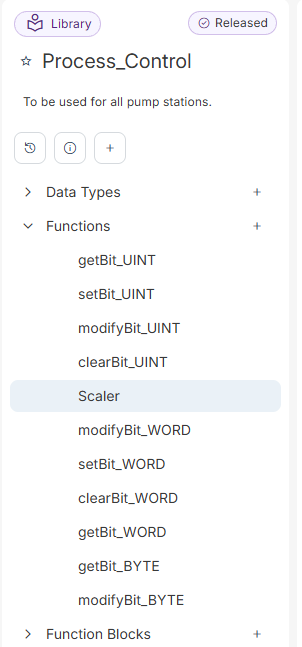

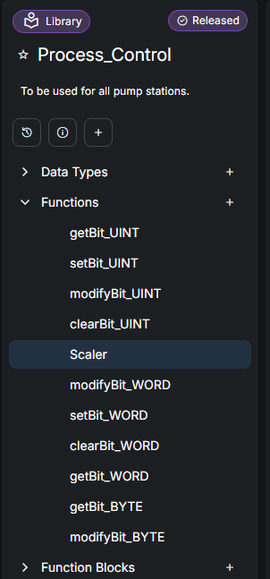

Press the star next to the library name to mark it as a favourite, and click the description below it to edit it. Of the three icons under the description, the left one opens the version history, the middle one opens **About this library**, and the (+) creates a new entity. The buttons at the top right of the editor depend on what you have open.

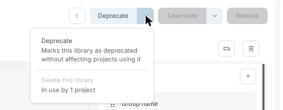

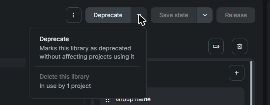

A new library starts as a draft. Build its content, press **Save** to keep your changes, and press **Release** to publish it as version 1.

Released versions never change. When you open a released version and make changes, press **Save state** and give the new saved state a name. Saved states stay linked to the library and are not visible to projects that use the released version. When you are happy with the result, press **Release** to publish it as the next version. OTee asks you to confirm, because projects that use the current version will need to update to get the changes.

The arrow next to **Save state** also offers **Duplicate**, which creates a standalone copy under a new library name that is not linked to the original. The **⋮** menu has **Export XML**, which downloads the open file as PLCopen XML, and, for drafts and saved states, a delete action. For a released library, **Delete this library** is in the arrow menu next to **Deprecate**. It is disabled while projects use the library.

If you leave the editor with unsaved changes, OTee asks whether you want to save them as a saved state or leave without saving.

## Versions and deprecation

Press the version history icon in the library editor, or choose **View version history** in the library's menu, to see every released version with its status and release date. Press a row to open that version.

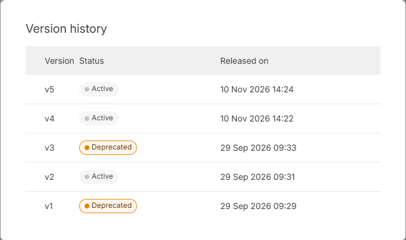

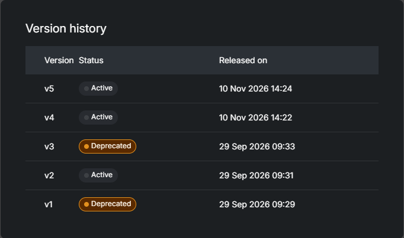

To go back to an earlier version, press the undo icon at the end of its row. OTee opens that version's content as a new saved state. Nothing is published until you release it, and no existing version changes. For a library whose latest version is deprecated, **Rollback** in the library's menu on the Libraries page does the same with the deprecated version.

**Deprecate** marks the open version as no longer recommended. Projects that already use it keep working, and deprecated versions are not suggested as updates. A library whose latest version is deprecated is no longer offered in the **Add Libraries** dialog. To publish a deprecated version again as a new version, open it and press **Release**.

## Use libraries in a project

When libraries are available, the project editor has a **Libraries** tab next to the **Project** tab. A line below the project name shows how many libraries are enabled in the project, and the **Configure** button opens the dialog for adding and removing them.

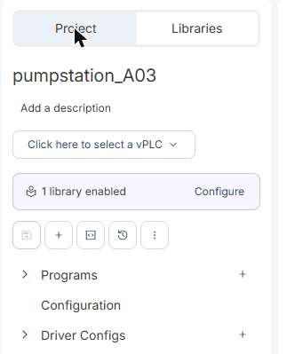

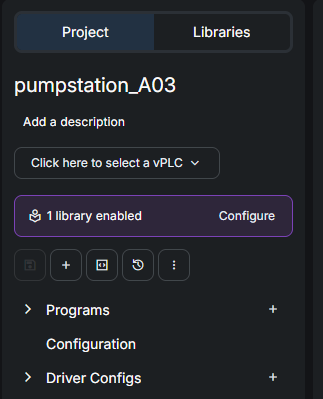

In the **Add Libraries** dialog, search for a library and press **Add** or **Remove**, then press **Apply** to confirm your selection. To change several libraries at once, tick their rows and use **Add selected** or **Remove selected**, which take effect immediately. The changes are saved together with the project. A library appears in the dialog with its latest released version, followed by its saved states and drafts, so you can also test a library before releasing it.

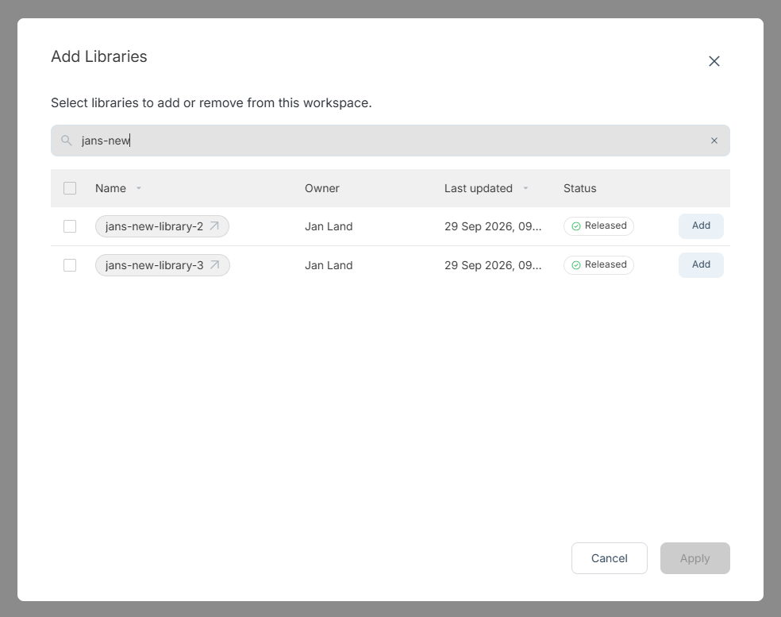

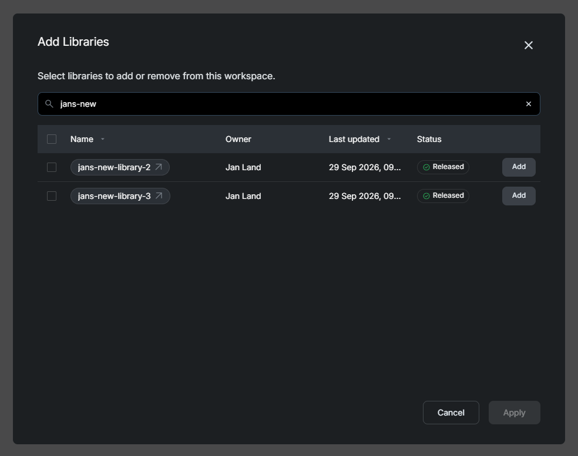

A project uses exactly the version you added. It does not change until you update it.

The **Libraries** tab lists the enabled libraries with their version. Open a library to browse its Data Types, Functions, and Function Blocks. Use **Sort** to change the order, **Show drafts** to show or hide libraries that use a saved state or draft, and **Expand all** or **Collapse all** to open or close every library.

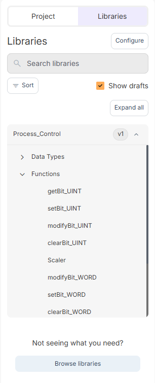

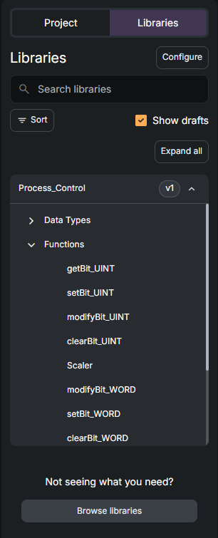

Entities from enabled libraries are available in your project like local ones. For example, you can choose a library data type or function block as the type of a variable and call library functions from your code or from the [Ladder Diagram](/projects/ladder-diagram) editor.

If an entity refers to something that is not available, for example because you imported a project without the library it uses, the entity shows a missing marker. Add the library with **Configure** to resolve it.

## Override a library entity

Library content is shared, so you do not edit it from a project. Press an entity in the **Libraries** tab to view it. If you change it, OTee creates a copy with the same name in your project, called an override, and your project uses the copy from then on. The library itself is not changed.

An override is marked with an icon, both next to the entity in the **Project** tab and in the **Libraries** tab. To remove the copy and use the library version again, press **Revert** next to the entity.

Overrides are kept when you update a library. If the new version of a library no longer includes an entity you have overridden, the override is marked with a warning and stays in your project until you revert it.

## Update a library

When a newer version of a library is available, its row in the **Libraries** tab shows the version change (for example v1 to v2) and an **Update library** button. A banner in the editor tells you that updates are available and offers **Update library** or **Update all**, and the line under the project name has a **Review** button.

Updating changes the version your project uses and saves the project. Deprecated versions are never offered as updates.
